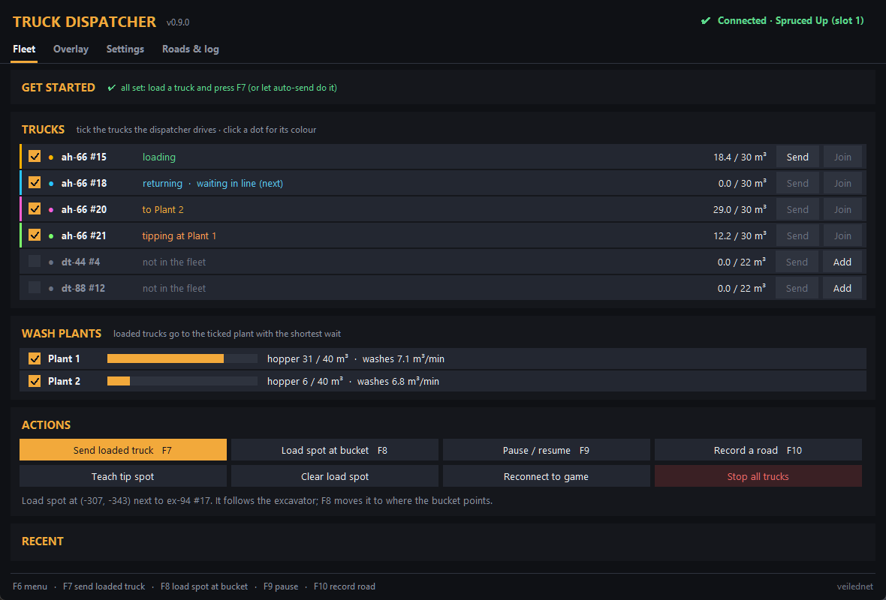
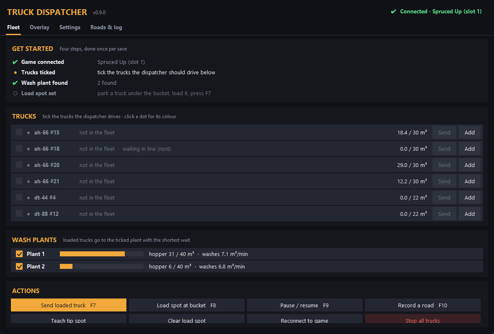
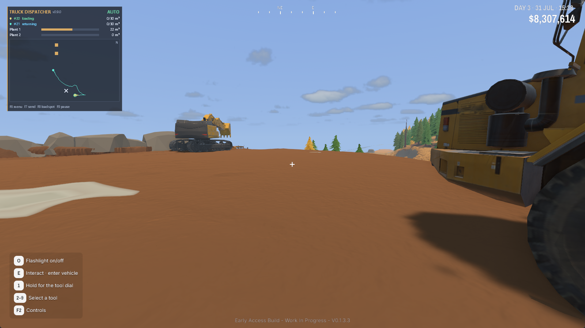
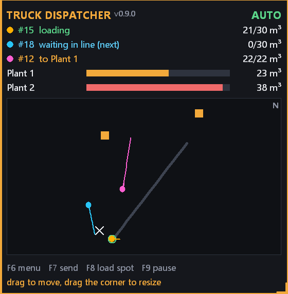
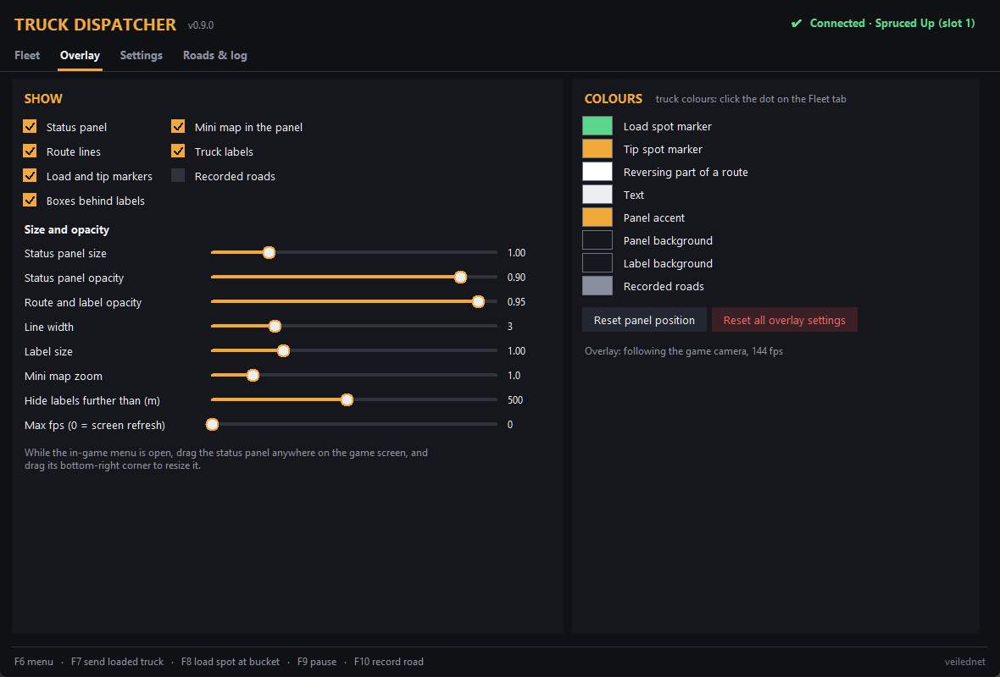

<p align="center"></p>

# Truck Dispatcher for Groundwork Simulator

Your dump trucks haul by themselves while you dig.

Load a truck with the excavator and it drives to the wash plant with the shortest wait, backs into the hopper, tips, and comes back to wait in line behind the truck you're loading. Use as many trucks and wash plants as you like.

- Trucks plan their own routes over the terrain: around trees, rocks, buildings, water and parked machines, slower in curves and on slopes
- Two or more wash plants: loaded trucks take turns so every plant keeps washing
- A queue at the excavator: the next truck moves under the bucket as soon as the loaded one pulls away
- Auto-send: a full truck leaves by itself, no key needed
- A menu inside the game (F6) with a setup checklist, and an overlay with route lines, labels and a status panel with a mini map
- Remembers the load spot, trucks and plants for each save

Single player. This is a fan tool, not made by or connected to the game's developers. It's a **beta** and I'd love to hear how it works for you (see [Feedback](#feedback)).

## Download

1. Go to [Releases](https://github.com/veilednet/groundwork-truck-dispatcher/releases/latest) and download **TruckDispatcher-v0.9.0.zip**.
2. Unzip it anywhere, your Desktop is fine.
3. Run **Truck Dispatcher.exe**.

If Windows says *"Windows protected your PC"*, click **More info** and then **Run anyway**. It shows that because the exe isn't signed. Some antivirus programs also don't like tools that read another program's memory. The full source code is right here, and you can run it with Python instead (see [For developers](#for-developers)).

## Use it

Start the tool before or after the game. It connects by itself once your save is loaded. Play in **borderless or windowed** mode (the game's default), because nothing can be drawn over exclusive fullscreen.

In the game press **F6**. The **Get started** box shows what's left to do:

1. Tick the trucks the dispatcher should drive.
2. Tick the wash plants it may use.
3. Park a truck under the excavator's bucket, load it and press **F7**.

That's it. From then on just keep loading. With auto-send on (the default), a truck leaves by itself when it's 95% full.

<p align="center"></p>

While you play, a small status panel shows every truck, the hoppers and a mini map with the routes:

<p align="center"></p>

| Key | What it does |
|---|---|
| **F6** | Menu over the game (Esc or F6 closes it) |
| **F7** | Send the loaded truck at the excavator. Idle trucks join the cycle. |
| **F8** | Put the load spot where the excavator's bucket points |
| **F9** | Pause / resume (trucks brake and wait) |
| **F10** | Start / stop recording a road |

The keys only work while the game is in front, so other programs keep them. You can change them in the menu, Settings tab.

If you get into a truck the dispatcher is driving, or drive one away from the load spot, the tool lets go of it. Press F7 or **Join** in the menu to give it back.

## Extras

- **Roads.** Press F10, drive a road in any machine, press F10 again. Trucks prefer it, in the direction you drove it. You can make it two-way in the menu.
- **Teach tip spot.** If a truck model stops short of the hopper or too far in, back one up to the hopper yourself and press *Teach tip spot*. It's remembered for that truck model.
- **Overlay.** Route lines, labels over the trucks, and a status panel with hopper levels and a mini map. Everything can be switched off, resized, recoloured and made more or less see-through. While the menu is open you can drag the status panel anywhere and drag its corner to resize it.
- **Settings.** Truck speeds, cornering, gaps in the line, the hopper limit and more.

<p align="center">
   
</p>

## Problems?

**"Not connected - the game's terrain doesn't match any autosave yet".** You just started or loaded a game. The tool reads your autosave to find things in the game's memory, so it waits for the next autosave (a few minutes) and then connects by itself.

**"Wash plant not found" or "Truck beds not found".** You built or bought something after the last autosave. Wait for the next autosave and press *Reconnect*.

**Nothing is drawn over the game.** Switch the game to borderless or windowed. If labels freeze for a few seconds after you switch view, that's normal: it's finding the new camera.

**A hotkey does nothing.** Another program probably uses it. Pick another key in the menu, Settings tab.

**A truck drives through something.** Trucks only know about trees, rocks, buildings, water, plants and machines. Dropped logs, small rocks and you on foot aren't in their plans. A machine that blocks a truck for a long time also gets driven through.

**Something else.** Open an [issue](https://github.com/veilednet/groundwork-truck-dispatcher/issues) and attach `dispatcher.log`. In the menu: Settings tab, *Open log*.

## Is it safe?

It never changes game files or save files. While it runs it writes into the game's memory: the positions of the trucks it drives, their tipper and cargo, and the wash plant hopper. The game's autosave then stores the result like normal play (trucks where they stopped, dirt in the hopper).

When the game closes or loads another save, the tool stops writing straight away. If a game update changes things so the data no longer looks right, it refuses to connect instead of guessing. It's still a beta though, so keep a backup of a save you care about.

How it works: the game only runs driving physics and tipping for the machine you're sitting in. So the tool moves idle trucks along their planned path itself (with steering and wheels animated), and tips by moving the bed's dirt into the hopper using the game's own amounts. The plant then washes it as normal.

Made for game version **0.1.3.3**. If an update changes how trucks are stored, tipping switches itself off (trucks still drive) until the tool is updated.

## Feedback

This is the first public version, so tell me what works and what doesn't. Things that help most:

- How many trucks and plants you use, and whether they got stuck anywhere
- Routes that look silly (a screenshot of the overlay is perfect)
- `dispatcher.log` from a session where something went wrong

Open an [issue](https://github.com/veilednet/groundwork-truck-dispatcher/issues) or find me on the Groundwork Discord.

## For developers

Python 3.11+ on Windows:

```bat
pip install -r requirements.txt
python app.py
```

`run.bat` does the same. Tests that need no game (they read one of your saves that has a wash plant and trucks):

```bat
python dev\edge_tests.py
python dev\sim_dispatch.py 4 10
```

`build.bat` builds the exe and the release zip into `dist\` (needs `pip install pyinstaller`).

| File | What it does |
|---|---|
| `app.py` | window, hotkeys, start-up |
| `dispatcher.py` | fleet, plants, queue, traffic, tipping |
| `planner.py` | route planner (2 m grid over the live terrain) |
| `motion.py` | paths, speed control, writing truck poses |
| `gdioverlay.py` | the overlay over the game (Win32 GDI) |
| `overlay.py` | the menu / control panel |
| `gamecam.py` | finds the game camera and window |
| `locate.py` | finds the loaded save and the game data in memory |
| `gwmem.py` | process memory access |
| `savelib\` | reads Groundwork save files (from the [Save Editor](https://github.com/veilednet/groundwork-save-editor)) |

## License

MIT, see [LICENSE](LICENSE).
